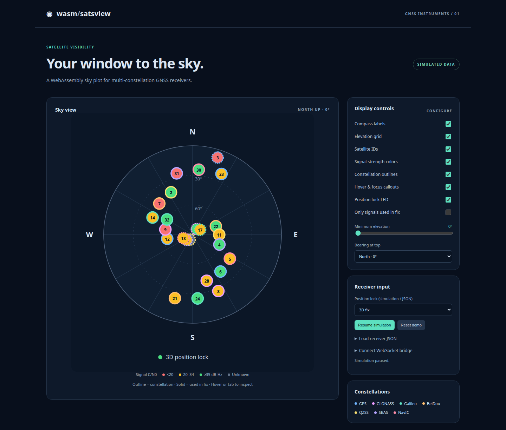

# wasm-satsview

A responsive GNSS satellite sky-view control. Rust compiled to WebAssembly
projects satellites and renders SVG; a small TypeScript wrapper supplies the
browser API, hover/focus details, and lifecycle management. No runtime JavaScript
dependencies, framework, or generated binding toolchain required.



The harness displaying simulated GNSS signals.

- North-up by default, with N/E/S/W outside the sky circle; optional rotation.
- Horizon at the rim, zenith at the center, optional elevation rings.
- Satellite circles: constellation-colored outlines and C/N0-colored fills.
- Satellite ID, constellation, signal, azimuth, elevation, C/N0 and fix usage
  in hover/focus details. Tab focuses signals; Escape dismisses the callout.
- Optional LED for 2D/3D lock, no lock, or unknown status.
- Interactive harness with display switches, filters, demo playback,
  JSON input, WebSocket input, and a received-signal table.
- Normalized snapshots and a stateful gpsd SKY/TPV adapter.

## Run locally

Install [Rust](https://rustup.rs/), Node.js 22 or later, and Python 3.12 or later
(for documentation). The stable Rust toolchain includes the WASM target.

```sh
npm ci
npm run dev
```

Open <http://127.0.0.1:5173>. The harness starts with **simulated** data.
`npm run dev` builds once; rerun it after source edits. `PORT=8080 npm run dev`
changes the server port. Build output is in `dist/`; use HTTP rather than opening
files directly.

## Embed in JavaScript or TypeScript

After `npm run build`, copy **all** of `dist/` into your application's static assets.
The WASM file must remain beside `index.js`, or supply its URL to `loadRenderer`.

```js
import { loadRenderer, SkyView } from './dist/index.js';

const view = new SkyView(document.querySelector('#sky'), await loadRenderer(), {
  showLock: true,
});
view.update({
  fix: '3d',
  satellites: [{
    id: '12', constellation: 'Galileo', azimuth: 70, elevation: 42,
    cn0: 39, used: true, signal: 'E1',
  }],
});
view.setOptions({ grid: false });
// When unmounting:
// view.destroy();
```

Typed entrypoints are generated as `dist/index.d.ts`. The package is initially
marked `private` to prevent accidental npm publication; public Git repositories
are independent of that setting.

## Receiver integration

Call `view.update(frame)` from your receiver transport. Each call replaces the
whole satellite snapshot; position lock is explicitly reported by the receiver,
never inferred from signal count. `fix` is `unknown`, `none`, `2d`, or `3d`.
Azimuth is degrees clockwise from true north, in [0, 360); elevation is degrees
in [-90, 90]. Below-horizon signals are retained in data but omitted from the plot.
`cn0` is optional C/N0 in dB-Hz, **not** dBm. Unknown C/N0 is gray; zero is a known
weak signal. Solid outlines indicate used-in-fix; dashed outlines indicate unused.

The demo accepts normalized JSON snapshots or gpsd SKY/TPV objects from a
WebSocket bridge. It does not connect directly to a USB serial device or gpsd's
TCP socket. See [receiver integration](docs/receivers.rst) for the bridge contract,
staleness handling, multi-device selection, and signal identity conventions.

## Checks and documentation

```sh
npm run build
npm test
npm run check
npx playwright install chromium
npm run test:browser
python3 -m venv .venv
.venv/bin/pip install -r docs/requirements.txt
.venv/bin/sphinx-build -W --keep-going -b html docs docs/_build/html
```

See [contributing](CONTRIBUTING.md), [CHANGES.md](CHANGES.md), and
[hosting setup](docs/publishing.rst). GitHub Actions checks code and builds Sphinx
on pushes and pull requests. Read the Docs rebuilds on pushes **after** you import
the GitHub repository into Read the Docs and enable its integration. A compatible
Gitea Actions workflow is also included; its runner must be configured separately.

## Public GitHub and Gitea repositories

Create empty **public** repositories named `wasm-satsview` on each service, without
an initial README or license, then use the actual URLs:

```sh
git remote add github git@github.com:YOUR_USER/wasm-satsview.git
git remote add gitea ssh://git@YOUR_GITEA/YOUR_USER/wasm-satsview.git
git push -u github main
git push gitea main
```

Push branches and tags to both services. The project contains no account-specific
URLs or credentials. Public visibility is set on the hosting services, not by Git.

## License

[MIT](LICENSE), copyright 2026 Dave Witten.
